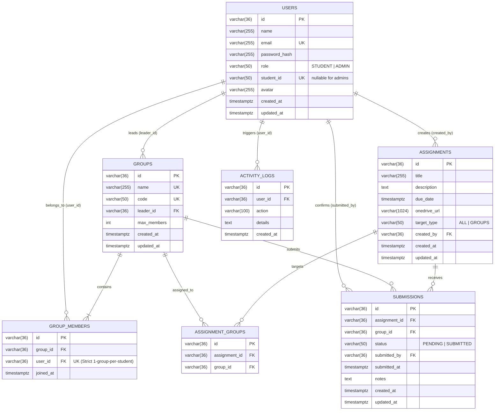

# Joineazy – Student, Group & Assignment Management System

[]()
[]()
[]()
[]()
[](https://render.com/deploy?repo=https://github.com/Govind-yada/Group-Ass_Managment_System)

A production-style, role-based academic platform built for the **Joineazy Full Stack Developer Internship Assessment**. Designed with enterprise SaaS aesthetics, normalized PostgreSQL relational modeling, JWT authentication, and an audited two-step declaration workflow for OneDrive assignment deliverables.

---

## Table of Contents
1. [Project Overview & Problem Statement](#1-project-overview--problem-statement)
2. [Key Features](#2-key-features)
3. [Mandatory Technology Stack](#3-mandatory-technology-stack)
4. [System Architecture](#4-system-architecture)
5. [JWT Authentication & Role-Based Access Control](#5-jwt-authentication--role-based-access-control)
6. [Database Schema & ER Diagram](#6-database-schema--er-diagram)
7. [Repository Folder Structure](#7-repository-folder-structure)
8. [REST API Endpoint Documentation](#8-rest-api-endpoint-documentation)
9. [Two-Step OneDrive Confirmation Workflow](#9-two-step-onedrive-confirmation-workflow)
10. [Local Development Setup](#10-local-development-setup)
11. [Docker & Containerized Deployment](#11-docker--containerized-deployment)
12. [Automated Test Execution](#12-automated-test-execution)
13. [Demo Credentials](#13-demo-credentials)
14. [Production Cloud Deployment Guide](#14-production-cloud-deployment-guide)

---

## 1. Project Overview & Problem Statement

### The Problem
In academic environments and university cohorts, group coursework often suffers from:
- Lack of transparency in student group formations and member capacity limits.
- Ambiguity over who submitted team deliverables on external storage drives (such as OneDrive).
- Difficulty for professors to track which student groups have declared submission vs. those with pending work.
- Inconsistent file submissions without an official audit trail.

### The Joineazy Solution
Joineazy bridges external cloud storage (OneDrive) with internal academic progress tracking:
- **Strict Role-Based Access:** Separate, protected workspaces for **Students** and **Professors (Admins)**.
- **Group Management:** Students can create a group, become group leader, and invite registered peers by Email or Student ID under a strict **one-group-per-student** policy.
- **OneDrive Integration:** Direct links to designated assignment folders on OneDrive.
- **Two-Step Submission Declaration:** Students declare completion through an explicit confirmation modal without pretending to scrape third-party cloud files. Every confirmation is persisted in PostgreSQL with student credentials, timestamps, and notes.
- **Live Visual Analytics:** Powered by Recharts and PostgreSQL database aggregations for real-time submission metrics and cohort progress tracking.

---

## 2. Key Features

### For Students
- **Dashboard Overview:** Metric cards for total assignments, completed submissions, pending deliverables, and overall group completion percentage with interactive progress bars.
- **Group Management:**
  - Create a group and receive an auto-generated unique Group Code (e.g., `GRP-ALPHA`).
  - Add members by registered University Email or Student ID.
  - Group capacity enforcement (e.g., 3–6 members).
  - Leader permission controls to remove members or manage team roster.
  - One-group-per-student constraint enforced at the PostgreSQL database level.
- **Assignment Hub & OneDrive Links:**
  - View all assignments targeted to the cohort or specific groups.
  - One-click launch to shared OneDrive folders in a new browser tab.
- **Two-Step Submission Confirmation:**
  - Step 1: Click "Yes, I have submitted".
  - Step 2: Confirmation modal: *"Are you sure your group has successfully uploaded the assignment to OneDrive?"*
  - Automatically records submitter's Student ID, name, timestamp, and declaration remarks.
  - Prevents duplicate confirmations and updates group progress immediately.
- **Submission History:** Audit trail of all declared group deliverables.
- **Profile & Settings:** Update profile information, avatar, and password.

### For Professors / Administrators
- **Executive Dashboard:** Aggregate metrics including total registered students, active groups, published assignments, completed/pending submissions, and overall completion rate.
- **Visual Analytics (Recharts):**
  - Assignment submission volume bar chart (submitted vs. pending groups).
  - Submission status ratio pie chart.
  - Group milestone completion progress horizontal bar chart.
  - Student cohort group participation breakdown (assigned vs. unassigned).
- **Assignment Management (CRUD):**
  - Create assignments with title, description, due date/time, and OneDrive URL.
  - Target assignments to **All Students** or **Specific Project Groups**.
  - Edit existing assignments or delete with safeguard confirmation modals.
- **Group Directory:** Search and filter student groups, inspect group rosters, view leader information, and examine group-wise submission status.
- **Dedicated Submission Monitoring Page:**
  - Granular table tracking: Assignment Title, Group Name, Member Rosters, Status, Confirmation Timestamp, Confirmed By (Student Name & Roll Number), and OneDrive Folder Link.
  - Search by assignment, group name, or student roll number.
  - Filter by status (`ALL`, `SUBMITTED`, `PENDING`) and assignment dropdown.
  - Sort by timestamp, status, or title.

---

## 3. Mandatory Technology Stack

| Layer | Technology | Details |
| :--- | :--- | :--- |
| **Frontend** | React 18, Vite | High-performance SPA with client-side routing |
| **Styling** | Tailwind CSS | SaaS design system inspired by Linear, Notion, and Vercel |
| **Icons & Charts** | Lucide React, Recharts | Accessible SVG icons and responsive SVG data visualizations |
| **State & HTTP** | Context API, Axios | Global session management and Axios request/response interceptors |
| **Routing** | React Router DOM v6 | Role-based protected routes and nested layouts |
| **Backend** | Node.js, Express.js | Modular MVC REST API architecture |
| **Database** | PostgreSQL, Prisma ORM | Relational database with foreign keys, constraints, and migrations |
| **Authentication** | JWT, bcryptjs | Bearer token authorization and salted password hashing (10 rounds) |
| **Validation** | Zod | Strict schema validation on all incoming API requests |
| **DevOps** | Docker, Docker Compose, Nginx | Multi-stage container builds and orchestrated local/production environment |

---

## 4. System Architecture

```
+-----------------------------------------------------------------------------------+
|                           CLIENT TIER (React 18 + Vite)                           |
|                                                                                   |
|  +--------------------+   +-----------------------+   +------------------------+  |
|  |   Public Routes    |   |    Student Layout     |   |      Admin Layout      |  |
|  |  (Login, Register) |   |  (Dashboard, Groups,  |   |   (Oversight, Monitor, |  |
|  |                    |   | Assignments, History) |   |   CRUD, Recharts)      |  |
|  +--------------------+   +-----------------------+   +------------------------+  |
|                                      |                                            |
|                                      v                                            |
|                  Axios API Client (JWT Bearer Interceptors)                       |
+--------------------------------------|--------------------------------------------+
                                       | HTTPS REST API (JSON)
                                       v
+-----------------------------------------------------------------------------------+
|                       BACKEND API TIER (Express.js / Node)                        |
|                                                                                   |
|  +-----------------------------------------------------------------------------+  |
|  | Middlewares: Helmet (Security) | CORS | RateLimiter | Morgan (Logger)       |  |
|  +-----------------------------------------------------------------------------+  |
|  | Authentication Guard: JWT Verification & Decoded Payload                     |  |
|  | Role-Based Authorization: requireRole('STUDENT') / requireRole('ADMIN')     |  |
|  | Input Validation Layer: Zod Request Schemas                                 |  |
|  +-----------------------------------------------------------------------------+  |
|  | Modular Controllers & Services: Auth, Groups, Assignments, Submissions, Logs |  |
|  +-----------------------------------------------------------------------------+  |
+--------------------------------------|--------------------------------------------+
                                       | SQL Queries & Transactions
                                       v
+-----------------------------------------------------------------------------------+
|                         PERSISTENCE TIER (PostgreSQL 15)                          |
|                                                                                   |
|  +---------------+  +----------------+  +-------------------+  +---------------+  |
|  |     users     |  |     groups     |  |   group_members   |  |  assignments  |  |
|  +---------------+  +----------------+  +-------------------+  +---------------+  |
|  |  submissions  |  |  assign_groups |  |   activity_logs   |  |   (Indexes)   |  |
|  +---------------+  +----------------+  +-------------------+  +---------------+  |
+-----------------------------------------------------------------------------------+
```

---

## 5. JWT Authentication & Role-Based Access Control

### How Authentication Works
1. **Password Hashing:** Passwords are never stored in plain text. When a student registers or an administrator updates credentials, the backend generates a cryptographic salt and hashes the password using `bcryptjs` (10 rounds).
2. **Token Issuance:** Upon successful verification in `POST /api/auth/login`, the server generates a JSON Web Token signed with `JWT_SECRET` containing the user's UUID, email, and role (`STUDENT` or `ADMIN`).
3. **Client Persistence:** The JWT is stored in `localStorage` and attached to the `Authorization: Bearer <token>` header of every outgoing request via Axios request interceptors.
4. **Session Expiry Handling:** If the JWT expires or is revoked, the Axios response interceptor intercepts the `401 Unauthorized` status, purges local session storage, and redirects the browser to `/login?expired=1`.
5. **Restricted Registration:** The public registration endpoint (`POST /api/auth/register`) strictly sets `role = 'STUDENT'`. Admin accounts cannot be created publicly and must be seeded or provisioned via database administrative governance.

### How Role-Based Access Control (RBAC) Works
Every sensitive endpoint is protected by a two-tier middleware guard:
```javascript
// Example: Creating an assignment requires valid JWT and ADMIN role
router.post('/', authenticate, requireRole('ADMIN'), validate(createAssignmentSchema), assignmentController.createAssignment);

// Example: Confirming submission requires valid JWT and STUDENT role
router.post('/:assignmentId/confirm', authenticate, requireRole('STUDENT'), validate(confirmSubmissionSchema), submissionController.confirmSubmission);
```
- If an unauthenticated user attempts to access protected endpoints, the server returns `401 Unauthorized`.
- If an authenticated student attempts to access professor endpoints, the server returns `403 Forbidden` (`Access denied. Role 'STUDENT' is not authorized`).
- On the frontend, `ProtectedRoute` checks the user's role against `allowedRoles`. Unauthorized access triggers redirection to the dedicated `/unauthorized` view.

---

## 6. Database Schema & ER Diagram

The database schema is fully normalized in PostgreSQL.



### Relational Integrity Highlights
- **1-Group-Per-Student Constraint:** Enforced via `UNIQUE(user_id)` on `group_members`. A student cannot belong to more than one group.
- **1-Submission-Per-Group-Per-Assignment:** Enforced via `UNIQUE(assignment_id, group_id)` on `submissions`. Prevents duplicate submission confirmations.
- **Cascade Deletions:** Deleting an assignment cascades to `assignment_groups` and `submissions` cleanly.

---

## 7. Repository Folder Structure

```
joineazy-system/
├── docker-compose.yml              # Multi-container orchestration (DB, Backend, Frontend)
├── .env.example                    # Global environment variable documentation
├── .gitignore                      # Git ignore rules for node_modules, build, logs, data
├── README.md                       # Comprehensive project documentation
│
├── backend/                        # Node.js + Express REST API Backend
│   ├── Dockerfile                  # Production container image
│   ├── package.json                # Dependencies and test runner scripts
│   ├── .env.example                # Backend environment variable template
│   ├── prisma/
│   │   └── schema.prisma           # Prisma schema definition
│   ├── src/
│   │   ├── app.js                  # Express application setup, middlewares, rate-limiting
│   │   ├── server.js               # HTTP server bootstrap and graceful shutdown
│   │   ├── config/                 # Environment configurations
│   │   ├── db/
│   │   │   ├── index.js            # Dual PostgreSQL adapter (pg Pool + PGlite fallback)
│   │   │   ├── schema.sql          # Relational DDL tables, indexes, constraints
│   │   │   └── seed.js             # Seed script for demo students, admins, groups, assignments
│   │   ├── middleware/
│   │   │   ├── auth.js             # JWT bearer verification middleware
│   │   │   ├── role.js             # Role authorization guard (STUDENT vs ADMIN)
│   │   │   ├── errorHandler.js     # Standardized error handling
│   │   │   └── validate.js         # Zod schema request validation middleware
│   │   ├── validators/             # Zod input schemas (auth, groups, assignments, submissions)
│   │   ├── controllers/            # Controller layer for HTTP request/response
│   │   ├── services/               # Business logic and database operations
│   │   ├── routes/                 # Express route definitions
│   │   └── utils/                  # API response formatters and JWT helpers
│   └── tests/
│       └── api.test.js             # Integration and logic test suite (10 test cases)
│
└── frontend/                       # React 18 + Vite SPA Frontend
    ├── Dockerfile                  # Multi-stage build with Nginx Alpine
    ├── nginx.conf                  # Nginx reverse proxy and SPA fallback routing
    ├── package.json                # Dependencies (Lucide, Recharts, Tailwind, etc.)
    ├── vite.config.js              # Vite bundler configuration
    ├── tailwind.config.js          # Custom theme and color extensions
    ├── postcss.config.js           # PostCSS autoprefixer configuration
    ├── index.html                  # HTML entry template
    └── src/
        ├── main.jsx                # React DOM entry point
        ├── App.jsx                 # Application routes and providers
        ├── index.css               # Tailwind CSS directives
        ├── context/
        │   ├── AuthContext.jsx     # Global authentication and session state
        │   └── ToastContext.jsx    # Toast notification system
        ├── services/
        │   └── api.js              # Axios instance with JWT interceptors
        ├── routes/
        │   └── ProtectedRoute.jsx  # Role-based route guard
        ├── layouts/
        │   ├── AuthLayout.jsx      # Clean centered auth layout
        │   ├── StudentLayout.jsx   # Student portal sidebar and responsive navbar
        │   └── AdminLayout.jsx     # Professor portal sidebar and responsive navbar
        ├── components/
        │   ├── ConfirmationModal.jsx # Two-step OneDrive confirmation modal
        │   ├── StatCard.jsx        # Metric cards with trend badges
        │   ├── ProgressBar.jsx     # Progress bar with color states
        │   ├── StatusBadge.jsx     # Submission and status pill badges
        │   ├── EmptyState.jsx      # Empty state with icon and action button
        │   └── LoadingSkeleton.jsx # Skeleton loaders
        └── pages/
            ├── auth/               # Login, Register, Unauthorized, NotFound
            ├── student/            # Dashboard, MyGroup, Assignments, Details, History, Profile
            └── admin/              # Dashboard, ManageAssignments, Create, Edit, Groups, Monitor, Analytics
```

---

## 8. REST API Endpoint Documentation

All endpoints return a standardized JSON response:
```json
{
  "success": true,
  "message": "Descriptive status message",
  "data": { ... }
}
```

### Authentication Endpoints (`/api/auth`)
| Method | Endpoint | Auth | Role | Description |
| :--- | :--- | :--- | :--- | :--- |
| `POST` | `/api/auth/register` | None | Public | Register new student account |
| `POST` | `/api/auth/login` | None | Public | Authenticate user and issue JWT |
| `GET` | `/api/auth/me` | Bearer | Any | Retrieve authenticated user profile & active group |
| `PUT` | `/api/auth/profile` | Bearer | Any | Update user name, avatar, or password |

### Group Endpoints (`/api/groups`)
| Method | Endpoint | Auth | Role | Description |
| :--- | :--- | :--- | :--- | :--- |
| `POST` | `/api/groups` | Bearer | `STUDENT` | Create new group (creator becomes Leader) |
| `GET` | `/api/groups/my-group` | Bearer | `STUDENT` | Get authenticated student's active group |
| `GET` | `/api/groups` | Bearer | Any | List all groups with search and pagination |
| `GET` | `/api/groups/:id` | Bearer | Any | Get group details, members roster, and leader info |
| `POST` | `/api/groups/:id/members` | Bearer | Leader/Admin | Add member by student email or student ID |
| `DELETE`| `/api/groups/:id/members/:userId` | Bearer | Leader/Admin | Remove member from group |

### Assignment Endpoints (`/api/assignments`)
| Method | Endpoint | Auth | Role | Description |
| :--- | :--- | :--- | :--- | :--- |
| `GET` | `/api/assignments` | Bearer | Any | Get assignments (filtered by student group vs all for admin) |
| `GET` | `/api/assignments/:id` | Bearer | Any | Get assignment details, instructions, and OneDrive URL |
| `POST` | `/api/assignments` | Bearer | `ADMIN` | Create new assignment (targets ALL or specific groups) |
| `PUT` | `/api/assignments/:id` | Bearer | `ADMIN` | Update assignment details and target groups |
| `DELETE`| `/api/assignments/:id` | Bearer | `ADMIN` | Delete assignment (cascades submissions cleanly) |

### Submission Endpoints (`/api/submissions`)
| Method | Endpoint | Auth | Role | Description |
| :--- | :--- | :--- | :--- | :--- |
| `POST` | `/api/submissions/:assignmentId/confirm` | Bearer | `STUDENT` | Two-step submission confirmation declaration |
| `GET` | `/api/submissions/:assignmentId` | Bearer | Any | Get submission declaration status for assignment |
| `GET` | `/api/submissions/history/my` | Bearer | `STUDENT` | Get student group's submission history |

### Admin & Analytics Endpoints (`/api/admin`)
| Method | Endpoint | Auth | Role | Description |
| :--- | :--- | :--- | :--- | :--- |
| `GET` | `/api/admin/dashboard` | Bearer | `ADMIN` | Overview metrics, upcoming deadlines, live activity feed |
| `GET` | `/api/admin/analytics` | Bearer | `ADMIN` | Recharts data series (assignment stats, group progress) |
| `GET` | `/api/admin/submissions`| Bearer | `ADMIN` | Submission monitoring records with search & filters |
| `GET` | `/api/admin/groups` | Bearer | `ADMIN` | Groups roster with member details & submission rates |

---

## 9. Two-Step OneDrive Confirmation Workflow

As mandated by Section 4.D, Joineazy implements an honest, declaration-based submission verification workflow:

```
[Student in Group]
       |
       | 1. Clicks "Open OneDrive Link"
       v
(Opens OneDrive in New Tab -> Student uploads files)
       |
       | 2. Returns to Joineazy & clicks "Yes, I have submitted"
       v
+--------------------------------------------------------------------------+
|                        CONFIRMATION MODAL POPUP                          |
|                                                                          |
| "Are you sure your group has successfully uploaded the assignment        |
|  to OneDrive?"                                                           |
|                                                                          |
| Notice: Submission confirmation is based on user declaration.            |
| Your timestamp and Student ID will be officially recorded.               |
|                                                                          |
|              [Cancel]              [Confirm Submission]                  |
+--------------------------------------------------------------------------+
       |
       | 3. User clicks "Confirm Submission"
       v
Backend records submission in PostgreSQL:
- status: "SUBMITTED"
- submitted_by: Student UUID
- submitted_at: Current timestamp (ISO 8601)
- notes: Declaration statement
- Duplicate prevention: Returns error if already submitted
- Immediate group progress update and toast success notification
```

---

## 10. Local Development Setup

### Prerequisites
- **Node.js** (v18.0.0 or higher, tested on Node v20/v24)
- **npm** (v9.0.0 or higher)
- **Git**

### Step 1: Clone Repository
```bash
git clone <repository-url>
cd joineazy-system
```

### Step 2: Configure Environment Variables
Copy `.env.example` in both `backend` and `frontend`:
```bash
# In backend/
cp backend/.env.example backend/.env

# In frontend/
cp frontend/.env.example frontend/.env
```

### Step 3: Install Dependencies & Seed Database
```bash
# Setup Backend
cd backend
npm install
npm run seed     # Seeds demo students, admin, groups, assignments

# Setup Frontend
cd ../frontend
npm install
```

### Step 4: Run the Application
In terminal 1 (Backend API):
```bash
cd backend
npm start
# Server runs on http://localhost:5000
```

In terminal 2 (Frontend Client):
```bash
cd frontend
npm run dev
# Frontend runs on http://localhost:5173
```

Open your browser at `http://localhost:5173`.

---

## 11. Docker & Containerized Deployment

The entire stack is configured with Docker Compose for seamless single-command execution.

### Run with Docker Compose
```bash
docker-compose up --build
```

### Services Started:
- **`joineazy_postgres`**: PostgreSQL 15 on port `5432` with persistent volume `postgres_data`.
- **`joineazy_backend`**: Express REST API on port `5000`.
- **`joineazy_frontend`**: Production-built React app served via Nginx on port `80` (and `5173`).

To run in the background (detached mode):
```bash
docker-compose up -d
```

To stop containers:
```bash
docker-compose down
```

---

## 12. Automated Test Execution

The backend contains an automated integration test suite validating authentication, authorization, group creation, membership constraints, assignment CRUD, and submission confirmations:

```bash
cd backend
npm test
```

### Test Suite Output:
```
▶ Joineazy Backend API Integration & Logic Test Suite
  ✔ 1. Auth: Student Login with valid credentials succeeds
  ✔ 2. Auth: Login with incorrect password throws 401
  ✔ 3. Auth: Registering duplicate student email throws 409
  ✔ 4. Auth: Registering a new student works cleanly
  ✔ 5. Groups: Student with existing group cannot create second group (1 group per student)
  ✔ 6. Groups: Unassigned student can create a new group
  ✔ 7. Assignments: Admin can create targeted assignment
  ✔ 8. Submissions: Two-step confirmation declaration records submission in PostgreSQL
  ✔ 9. Submissions: Duplicate submission confirmation is prevented
  ✔ 10. Admin: Analytics and Dashboard statistics return accurate PostgreSQL aggregations
✔ Joineazy Backend API Integration & Logic Test Suite
ℹ tests 10
ℹ pass 10
ℹ fail 0
```

---

## 13. Demo Credentials

The database is pre-seeded with realistic sample accounts. You can use the **Quick Demo Login Fill** buttons on the `/login` page or enter the credentials below:

### 1. Professor / Administrator Account
- **Email:** `admin@joineazy.edu`
- **Password:** `Password@123`
- **Role:** `ADMIN`
- **Name:** Prof. Alexander Vance

### 2. Student Leader (Team Alpha)
- **Email:** `alice@student.joineazy.edu`
- **Password:** `Password@123`
- **Role:** `STUDENT`
- **Name:** Alice Johnson (Student ID: `CS202601`)
- **Group:** Leader of *Team Alpha*

### 3. Student Member (Team Alpha)
- **Email:** `bob@student.joineazy.edu`
- **Password:** `Password@123`
- **Role:** `STUDENT`
- **Name:** Bob Smith (Student ID: `CS202602`)
- **Group:** Member of *Team Alpha*

### 4. Student Leader (Byte Builders)
- **Email:** `david@student.joineazy.edu`
- **Password:** `Password@123`
- **Role:** `STUDENT`
- **Name:** David Miller (Student ID: `CS202604`)
- **Group:** Leader of *Byte Builders*

### 5. Unassigned Student (No Group Yet)
- **Email:** `fiona@student.joineazy.edu`
- **Password:** `Password@123`
- **Role:** `STUDENT`
- **Name:** Fiona Gallagher (Student ID: `CS202606`)
- **Group:** *None* (Can create a new group or be invited)

---

## 14. Deploying on Render (Recommended Cloud Platform)

Joineazy includes a pre-configured Infrastructure-as-Code Blueprint (`render.yaml`) for one-click deployment of the entire stack (PostgreSQL Database, Node/Express Backend, and React Vite Frontend).

### Option A: One-Click Deploy Button (Fastest)

Click the button below to deploy the entire stack to Render:

[](https://render.com/deploy?repo=https://github.com/Govind-yada/Group-Ass_Managment_System)

### Option B: Deploy via Render Dashboard (Blueprint)

1. Sign in to your [Render Dashboard](https://dashboard.render.com).
2. Click **New +** at the top right and select **Blueprint**.
3. Connect your GitHub account and select the repository: `Govind-yada/Group-Ass_Managment_System`.
4. Render automatically parses `render.yaml` and sets up:
   - **`joineazy-postgres`**: Managed PostgreSQL 15 database instance (Free tier).
   - **`joineazy-backend`**: Node.js Express API with auto-injected `DATABASE_URL`, auto-running migrations and seeds.
   - **`joineazy-frontend`**: Static Site serving the Vite React SPA with SPA rewrite rules (`/*` -> `/index.html`).
5. Click **Apply**. Render will deploy all three services within 2–3 minutes.

### Option C: Manual Service Configuration on Render

If you prefer to configure each service manually:

#### 1. PostgreSQL Database
- **New +** -> **PostgreSQL**
- Name: `joineazy-postgres`
- Database: `joineazy_db`
- User: `joineazy_user`
- Plan: `Free`
- Copy the **Internal Database URL** once created.

#### 2. Backend Web Service
- **New +** -> **Web Service**
- Connect `Govind-yada/Group-Ass_Managment_System`
- Root Directory: `backend`
- Environment: `Node`
- Build Command: `npm install && npm run build`
- Start Command: `npm start`
- Add Environment Variables:
  - `NODE_ENV`: `production`
  - `PORT`: `5000`
  - `DATABASE_URL`: *(paste the Internal Database URL)*
  - `JWT_SECRET`: *(enter any secure random string)*
  - `JWT_EXPIRES_IN`: `7d`
  - `CLIENT_URL`: `*`

#### 3. Frontend Static Site
- **New +** -> **Static Site**
- Connect `Govind-yada/Group-Ass_Managment_System`
- Root Directory: `frontend`
- Build Command: `npm install && npm run build`
- Publish Directory: `dist`
- Add Redirect / Rewrite Rule:
  - Type: `Rewrite`
  - Source: `/*`
  - Destination: `/index.html`
- Add Environment Variable:
  - `VITE_API_URL`: `https://<your-backend-service-name>.onrender.com/api`

---

## Author & Assessment Information
- **Candidate:** Full Stack Developer Intern Candidate
- **Assessment For:** Joineazy Developer Evaluation
- **Submission Date:** November 2026
